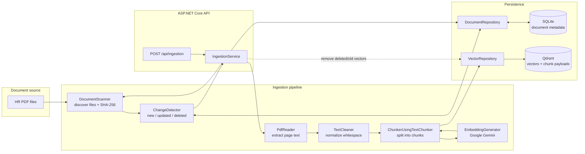

# HR RAG System

<p align="center">
  <strong>Document ingestion foundation for semantic search over HR PDFs</strong><br>
  Built with .NET 10, Google Gemini embeddings, SQLite, and Qdrant.
</p>

<p align="center">
  
  
  
  
  
</p>

HR RAG System is an ASP.NET Core Web API that scans a configured folder for HR PDF files, detects additions, changes, and removals, and indexes document chunks as vector embeddings in Qdrant. SQLite stores document metadata and file hashes so unchanged files can be skipped on later ingestion runs.

> **Current scope:** The working API endpoint triggers document ingestion. A Qdrant similarity-search method exists in `VectorRepository`, but the retrieval controller and retrieval service are currently empty and are not registered in dependency injection. This repository does not yet expose a question-answering/chat API.

## At a glance

- Recursively scans a configured directory for PDF documents.
- Uses SHA-256 file hashes to detect changed content.
- Extracts text from PDFs with PdfPig and normalizes whitespace.
- Splits text into overlapping chunks and generates an embedding for each chunk through Google Gemini.
- Stores document metadata in SQLite and chunk vectors/payloads in Qdrant.
- Provides an ingestion endpoint at `POST /api/ingestion`.

## Architecture



### Ingestion lifecycle

1. A client calls `POST /api/ingestion`.
2. `DocumentScanner` recursively enumerates PDFs in `DataFolderPath`, creates metadata, and calculates SHA-256 hashes.
3. `DocumentRepository` loads existing records; `ChangeDetector` compares relative paths and hashes to classify new, updated, and deleted documents.
4. Deleted files have their Qdrant vectors and SQLite metadata removed.
5. New and updated PDFs are read, cleaned, chunked, and embedded. Updated documents have their old vectors deleted before replacement chunks are upserted.
6. Document metadata is upserted into SQLite, while embeddings and chunk payloads are upserted into Qdrant.

## Tech stack

| Area | Technology | Use in this project |
|---|---|---|
| Runtime and web framework | .NET 10, ASP.NET Core | HTTP API, dependency injection, configuration, and hosting |
| API description | ASP.NET Core OpenAPI, Swagger UI | OpenAPI document and development-time API UI |
| Metadata persistence | SQLite, Entity Framework Core | Document records, file hashes, and change tracking |
| Vector database | Qdrant .NET client | Collection management and chunk-vector storage; includes a similarity-query method |
| Embedding provider | Google Gemini through `Mscc.GenerativeAI.Microsoft` | Generates vectors for document chunks |
| Text chunking | `Microsoft.SemanticKernel` TextChunker | Splits cleaned document text into chunks with overlap |
| PDF extraction | `UglyToad.PdfPig` | Reads text from PDF pages |
| Additional package | `sqlite-vec` | Referenced by the project; the current ingestion implementation writes vectors to Qdrant |

Package versions are maintained in [`HRRagSystem/HRRagSystem.csproj`](HRRagSystem/HRRagSystem.csproj).

## Service catalog

| Service | Responsibility |
|---|---|
| `IngestionService` (`IIngestionService`) | Coordinates the ingestion lifecycle: scans files, compares stored metadata, handles deletions, and processes new or changed PDFs through the pipeline. |
| `DocumentScanner` (`IDocumentScanner`) | Recursively finds PDF files under the configured data directory and returns file metadata, relative paths, and SHA-256 hashes. |
| `ChangeDetector` (`IChangeDetector`) | Compares scanned documents against database records by relative path and hash; returns new, updated, and deleted document sets. |
| `PdfReader` (`IPdfReader`) | Extracts text from each page of a PDF using PdfPig. |
| `TextCleaner` (`ITextCleaner`) | Normalizes line endings, repeated spaces/tabs, and excessive blank lines in extracted text. |
| `ChunkerUsingTextChunker` (`IChunker`) | Uses Semantic Kernel's `TextChunker` to split text into chunks, estimates token counts, attaches document metadata, and requests an embedding per chunk. Current limits are configured in the class (100 tokens per line, 200 tokens per paragraph, 20-token overlap). |
| `EmbeddingGenerator` (`IEmbeddingGenerator`) | Calls the configured Gemini embedding model and returns the generated `float[]` vector. |
| `DocumentRepository` (`IDocumentRepository`) | Reads, upserts, and deletes document metadata through the EF Core SQLite context. |
| `VectorRepository` (`IVectorRepository`) | Ensures the Qdrant collection exists, upserts chunk vectors and payloads, deletes vectors by document ID, and has a similarity-query method. |
| `HRRagSystemSQLiteDbContext` | Defines the SQLite `Documents` set and document key/required-field/unique-relative-path rules. |

### Dependency injection lifetimes

`Program.cs` registers the document-processing and repository services as scoped. `EmbeddingGenerator` and `QdrantClient` are singletons; the EF Core DbContext is registered using `AddDbContext`.

## API

### Trigger document ingestion

```http
POST /api/ingestion
```

No request body is required. The endpoint awaits `PerformIngestAsync` and returns `200 OK` when ingestion completes. Cancellation is passed through the request pipeline.

In Development, the app maps the OpenAPI specification at `/openapi/v1.json` and enables Swagger UI. Check the URL printed by `dotnet run` for the local host and port.

## Configuration

The application reads configuration from its JSON settings and the standard .NET configuration providers. Relevant keys:

| Key | Purpose |
|---|---|
| `DataFolderPath` | Root directory to scan recursively for PDF files. |
| `ConnectionStrings:DefaultConnection` | SQLite connection string. |
| `Qdrant:Host` | Qdrant host name. |
| `Qdrant:GrpcPort` | Qdrant gRPC port. |
| `Qdrant:CollectionName` | Vector collection name. |
| `Qdrant:VectorSize` | Expected vector dimension; must match the configured Gemini embedding model. |
| `GeminiApiKey` | Gemini API credential. Supply as a secret, not a committed value. |
| `GeminiModel` | Embedding model identifier used by the embedding generator. |

Example configuration shape (use your own paths and valid model settings):

```json
{
  "DataFolderPath": "./hr-documents",
  "ConnectionStrings": {
	"DefaultConnection": "Data Source=HRRagSystem.db"
  },
  "Qdrant": {
	"Host": "localhost",
	"GrpcPort": 6334,
	"CollectionName": "HRDocumentsChunks",
	"VectorSize": 768
  }
}
```

The Gemini settings are intentionally not included in this JSON sample. Configure them with User Secrets or environment variables. For example, from the `HRRagSystem` project directory:

```powershell
dotnet user-secrets set "GeminiApiKey" "YOUR_GEMINI_API_KEY"
dotnet user-secrets set "GeminiModel" "YOUR_EMBEDDING_MODEL"
```

The checked-in `appsettings.json` currently contains a machine-specific `DataFolderPath`; replace it with a path appropriate to your environment. Do not commit credentials or confidential HR files.

## Run locally

### Prerequisites

- .NET 10 SDK
- A Google Gemini API key and a supported embedding model
- Qdrant running and reachable at the configured gRPC host/port

### 1. Start Qdrant

For local development with Docker:

```powershell
docker run --name qdrant -p 6333:6333 -p 6334:6334 qdrant/qdrant
```

### 2. Configure the application

Set `DataFolderPath`, the SQLite connection string, and Qdrant settings in local configuration. Configure `GeminiApiKey` and `GeminiModel` using User Secrets as shown above. Confirm `Qdrant:VectorSize` matches the chosen embedding model output dimensions.

### 3. Restore and run

From the repository root:

```powershell
dotnet restore
dotnet run --project .\HRRagSystem\HRRagSystem.csproj
```

### 4. Ingest documents

Call the API route using the base URL printed in the console:

```powershell
Invoke-RestMethod -Method Post -Uri "https://localhost:<port>/api/ingestion"
```

For local HTTPS development, trust the .NET development certificate if your client reports a certificate error.

## Data model overview

- **`DocumentInfo`** is the SQLite document record: ID, file name, relative path, hash, file size, timestamps, ingestion version, and status.
- **`DocumentChunk`** is the unit indexed in Qdrant: chunk ID, document ID, file name, chunk index, text content, estimated token count, embedding, and ingestion version.
- Qdrant payloads include the document ID, file name, chunk index, content, token count, and ingestion version, enabling results to be associated with their source document.

## Project layout

```text
HRRagSystem/
├── HRRagSystem.slnx
├── README.md
└── HRRagSystem/
	├── Controllers/          # HTTP API controllers
	├── Database/             # EF Core SQLite DbContext
	├── Migrations/           # EF Core migrations and model snapshot
	├── Models/                # Document and chunk models
	├── Services/
	│   ├── Interfaces/       # Service contracts
	│   └── Implementation/   # Ingestion and persistence services
	├── Data/                  # Configured PDF input folder (keep private PDFs out of Git)
	├── Program.cs             # Dependency injection and API pipeline
	├── HRRagSystem.csproj
	└── appsettings*.json
```

## Current limitations and next steps

- The retrieval controller, retrieval service, and retrieval interface are placeholders. Similarity search exists at the vector repository layer but is not exposed as an HTTP endpoint.
- There is no LLM answer-generation/chat flow in the current API.
- The configured embedding size must be compatible with the selected Gemini embedding model and the Qdrant collection.
- Ingestion is started by an API request; no background schedule is configured.

## Security

- Keep Gemini credentials in .NET User Secrets or a secure environment-specific secret store.
- Avoid committing real employee/HR PDFs, database files, API keys, or machine-specific paths.
- Restrict access to the document directory and Qdrant instance appropriately for your deployment.
